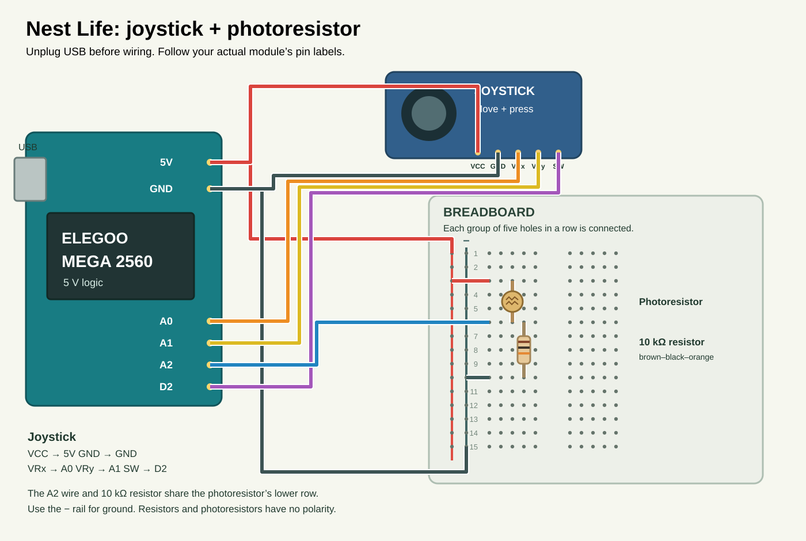

# Nest Life controller wiring

The current demo uses an ELEGOO Mega 2560, a joystick, and a photoresistor. Unplug the Mega's USB cable while making or changing connections.

## Parts

- ELEGOO Mega 2560 and USB data cable
- Joystick module
- Photoresistor and a 10 kΩ resistor
- Breadboard and jumper wires

## Visual wiring



[Open the full-size diagram](images/elegoo-joystick-light.svg). Place the resistor and photoresistor leads in the rows shown; the A2 jumper shares the photoresistor/resistor junction.

## Connections

| Part | Pin or lead | Connect to |
| --- | --- | --- |
| Joystick | VCC / +5V | Mega 5V |
| Joystick | GND | Mega GND |
| Joystick | VRx | Mega A0 |
| Joystick | VRy | Mega A1 |
| Joystick | SW | Mega digital pin 2 |
| Breadboard | + rail | Mega 5V |
| Breadboard | − rail | Mega GND |
| Photoresistor | One leg | Breadboard + rail |
| Photoresistor | Other leg | Mega A2 and one end of the 10 kΩ resistor |
| 10 kΩ resistor | Other end | Breadboard − rail |

Use a second Mega 5V or GND pin, or share the breadboard power rails, if needed. Place the two photoresistor legs in separate breadboard rows. The A2 jumper and the 10 kΩ resistor lead share the row with one photoresistor leg. Neither resistor has polarity.

```text
Mega 5V ── photoresistor ──┬── 10 kΩ resistor ── Mega GND
                           │
                         Mega A2
```

## Test and play

1. Check the wiring, connect USB, and upload [NestLifeJoystick.ino](../hardware/elegoo/NestLifeJoystick/NestLifeJoystick.ino) to the Mega. It sends joystick and light readings at 115200 baud.
2. Close Arduino IDE's Serial Monitor before connecting from the game.
3. Start the game on this computer, enter campus, and switch the ELEGOO controller on. In Linux development mode, the local bridge starts with `npm run dev`.
4. In controller settings, check that joystick readings change when you move it and that the light reading falls when you cover the photoresistor.
5. Room-light control is enabled by default. Readings at or below 400 set night, readings at or above 600 set day, and the game transitions gradually between them. You can turn this off in controller settings.

The controller is unavailable while other players are connected. Keyboard and mouse remain available.
