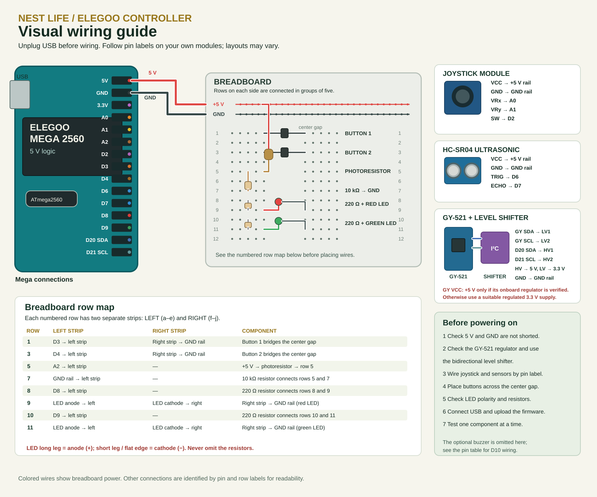

# Nest Life ELEGOO controller: wiring and setup

This is the optional controller wiring for Nest Life. Power the Mega off and unplug USB while wiring. Each signal uses a different pin. The photoresistor and LEDs are optional for initial individual tests; leave RFID and LCD1602 disconnected.

## Parts

- ELEGOO Mega 2560 R3 and a USB data cable.
- One joystick module with VRx, VRy and SW; one HC-SR04 ultrasonic module; one GY-521 MPU-6050 breakout.
- One photoresistor, one 10 kΩ resistor for its voltage divider, two momentary push buttons.
- One red LED and one green LED, each with its own 220 Ω resistor (330 Ω also works).
- Breadboard and jumper wires.
- **One bidirectional 5 V / 3.3 V I²C level-shifter module** (two channels minimum). This is an additional part unless already in your kit; do not assume it is included. Optional: a small active buzzer.

ELEGOO lists the GY-521 in its [Mega Most Complete Starter Kit](https://us.elegoo.com/products/elegoo-mega-2560-the-most-complete-starter-kit); contents can vary. Verify the labels on your actual modules.

## Visual wiring diagram

[Open the full-size visual diagram](images/elegoo-visual-wiring.svg). The colored lines show the breadboard power rails; the pin and row labels specify the remaining connections without obscuring the components.

The two rails marked +5 V and GND run along the breadboard. The 3.3 V connection below goes to the shifter's LV supply, **not** to the 5 V rail. All grounds are common.

~~~mermaid
flowchart LR
 USB["Computer USB"] --> MEGA["ELEGOO Mega 2560"]
 MEGA -- "5V" --> P5["+5 V breadboard rail"]
 MEGA -- "GND" --> G["GND breadboard rail"]
 MEGA -- "3.3V" --> LV["3.3 V to shifter LV"]
 P5 --> J["Joystick VCC"]
 G --> JG["Joystick GND"]
 JX["Joystick VRx"] --> A0["Mega A0"]
 JY["Joystick VRy"] --> A1["Mega A1"]
 JS["Joystick SW"] --> D2["Mega D2"]
 P5 --> U["HC-SR04 VCC"]
 G --> UG["HC-SR04 GND"]
 D6["Mega D6"] --> TRIG["HC-SR04 TRIG"]
 ECHO["HC-SR04 ECHO"] --> D7["Mega D7"]
 P5 --> LDR["Photoresistor"] --> NODE["Divider junction → Mega A2"]
 NODE --> R10["10 kΩ resistor"] --> G
 D3["Mega D3"] --> B1["Button 1"] --> G
 D4["Mega D4"] --> B2["Button 2"] --> G
 D8["Mega D8"] --> R220A["220 Ω"] --> RED["Red LED anode"]
 RED --> G
 D9["Mega D9"] --> R220B["220 Ω"] --> GREEN["Green LED anode"]
 GREEN --> G
 P5 --> SHIFT["Bidirectional I²C shifter HV"]
 LV --> SHIFT
 G --> SHIFT
 SDA["Mega D20 / SDA"] --> SHIFT
 SCL["Mega D21 / SCL"] --> SHIFT
 SHIFT -- "LV SDA and LV SCL" --> GY["GY-521 SDA and SCL"]
 P5 -- "GY-521 VCC, only on regulated breakout" --> GY
 G -- "GY-521 GND" --> GY
~~~

For the LED symbol, the anode is the long leg and the cathode is the short leg/flat side; connect each cathode to ground. Do not put an LED directly between a pin and ground without its resistor.

## Pin assignments

| Component | Component connection | Mega / breadboard connection |
|---|---|---|
| Joystick | VCC, GND, VRx, VRy, SW | +5 V rail, GND rail, A0, A1, D2 |
| HC-SR04 | VCC, GND, TRIG, ECHO | +5 V rail, GND rail, D6, D7 |
| GY-521 | VCC, GND | +5 V and GND **only if the breakout has its 3.3 V regulator** |
| GY-521 | SDA, SCL | Shifter LV1, LV2 |
| I²C shifter | HV, LV, GND | +5 V rail, Mega 3.3 V, GND |
| I²C shifter | HV1, HV2 | D20 SDA, D21 SCL |
| Photoresistor | One leg to +5 V; other leg to A2 junction | 10 kΩ from junction to GND |
| Button 1 | One side D3, opposite side GND | Internal pull-up enabled in firmware |
| Button 2 | One side D4, opposite side GND | Internal pull-up enabled in firmware |
| Red LED | D8 → 220 Ω → anode; cathode → GND | D8 |
| Green LED | D9 → 220 Ω → anode; cathode → GND | D9 |
| Optional active buzzer | Positive D10, negative GND | D10 |

The [Mega pinout](https://docs.arduino.cc/resources/pinouts/A000067-full-pinout.pdf) identifies D20/D21 as SDA/SCL. The [Mega schematic](https://docs.arduino.cc/resources/schematics/A000067-schematics.pdf) shows 5 V pull-ups on I²C, while the [MPU-6050 datasheet](https://invensense.tdk.com/wp-content/uploads/2015/02/MPU-6000-Datasheet.pdf) specifies 3.3 V-domain logic. Therefore use the bidirectional shifter; never connect the Mega's 5 V I²C lines directly to an unverified 3.3 V sensor. The GY-521's VCC supply depends on its onboard regulator: confirm its exact board and measure the regulated rail before connecting; if it has no regulator, use a suitable regulated 3.3 V supply instead. Leave AD0, INT, XDA and XCL unconnected. Do not connect +5 V and +3.3 V rails together.

## Assembly

1. With USB unplugged, connect Mega 5 V and GND to separate breadboard rails. If the breadboard rails are split, bridge each half of the same rail.
2. Wire joystick power, A0/A1 and D2. Confirm SW connects to ground when pressed.
3. Wire ultrasonic VCC, GND, TRIG and ECHO exactly as labeled on your module.
4. Wire the light divider: +5 V → photoresistor → A2 junction → 10 kΩ → ground.
5. Wire each push button across the breadboard center gap: one side to D3/D4 and the opposite side to ground. The firmware uses INPUT_PULLUP, so pressed reads LOW.
6. Wire each LED in series with its own 220 Ω resistor between D8/D9 and ground.
7. Wire the level shifter HV to +5 V, LV to Mega 3.3 V, and GND to ground. Connect D20/D21 to HV1/HV2, then the matching LV1/LV2 to GY-521 SDA/SCL. Connect the GY-521 supply according to the voltage check above.
8. Check every connection and polarity, then connect USB. The Mega 3.3 V pin is rated for at most 50 mA; it is used only for the level-shifter low side here.

## Test each part

Upload [the controller firmware](../hardware/elegoo/NestLifeController.ino) at 115200 baud. With the board connected, use the Arduino IDE Serial Monitor at the firmware's stated baud rate; close the monitor before connecting from the browser because only one program can own the port.

- Joystick: center, move in all four directions, then press SW. Values should change and the switch should toggle.
- Buttons: press each and verify its separate input changes; it should return when released.
- Ultrasonic: move a hand inside ~10 cm, move it beyond the reset distance, then repeat. One approach should produce one event.
- GY-521: hold level, calibrate, tilt left/right, and verify opposite signs. If readings are absent, first check the level shifter and its 3.3 V/5 V supplies.
- Photoresistor: uncover and cover it; the A2 reading should change substantially.
- LEDs: run the firmware's output test or send its documented commands; verify red and green separately.
- Finally test with the game on the same computer using a Web Serial capable Chromium browser at http://localhost or HTTPS. [Web Serial requires a secure context](https://developer.mozilla.org/en-US/docs/Web/API/Web_Serial_API); the plain LAN IP URL used on the phone is not sufficient.

## Integration approach

The controller can be toggled on or off during normal campus play. Its inputs control only the local player; normal movement and activity events are synchronized through the existing multiplayer system. Keyboard and mouse remain available. On Linux, the development server starts a local USB bridge when available. The joystick-only sketch can be used to test movement before wiring the remaining components.
